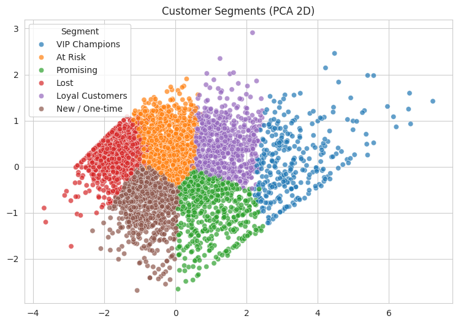

# Customer Segmentation with K-Means (RFM Analysis)

Segmenting 4,321 customers of a UK online retailer into 6 behavioral groups using RFM features and K-Means, then turning the segments into marketing recommendations.

## 1. Problem
Marketing to every customer the same way wastes budget: a customer who buys every week and one who bought once a year need very different treatment. The goal of this project is to group customers by their purchasing behavior so that the business can decide who to reward, who to win back, and who is not worth a large budget.

## 2. Dataset
- **Source:** [UCI Online Retail](https://archive.ics.uci.edu/dataset/352/online+retail)
- A UK-based online retailer that sells all-occasion gifts; many customers are wholesalers
- 541,909 transactions between 01/12/2010 and 09/12/2011
- The raw file is not included in this repo (22 MB). Download `Online Retail.xlsx` from the link above and place it next to the notebook.

## 3. Data Cleaning
| Step | Reason |
|---|---|
| Dropped rows without `CustomerID` (~25% of rows) | A transaction can't be assigned to a customer, so RFM can't be computed |
| Dropped duplicate rows (5,268) | Repeated records |
| Dropped cancelled invoices (`InvoiceNo` starts with `C`) | Returns, not purchases |
| Dropped `Quantity <= 0` and `UnitPrice <= 0` | Stock adjustments, not real sales |
| Dropped non-product codes (`POST`, `M`, `C2`, `DOT`, `BANK CHARGES`) | Service fees would inflate Frequency and Monetary |
| Dropped purchases that have a matching cancellation (5,221 rows) | e.g. an order of 80,995 units that was cancelled the same day |
| Dropped `UnitPrice < 0.01` | Placeholder price (£0.001) |

**Result:** 541,909 rows reduced to about 385,900 rows covering 4,321 customers.

> **Assumption:** a purchase is treated as cancelled when the same customer has a cancellation row with the same product and the exact negative quantity. This may also remove a few genuine purchases that were fully returned, but their net effect is zero anyway.

## 4. Exploratory Data Analysis
- **Countries:** the UK accounts for about 90% of customers (3,906 of 4,321) and about 84% of revenue. A few countries have very few customers but high spend (for example the Netherlands: 9 customers, about £282K), which points to wholesale buyers.
- **Seasonality:** monthly revenue grows through the year and peaks in November (about £1.1M), consistent with Christmas gift buying. The drop in December 2011 is not real, because the data ends on 9 December.
- **Skewed distributions:** Quantity, UnitPrice and TotalPrice are heavily right-skewed (the mean is far above the median and the max is far above the 75th percentile) because of a small number of large wholesale orders. These were kept as real behavior and handled later with a log transform.
- **Large outliers were investigated, not just deleted:** the biggest "orders" (80,995 and 74,215 units) turned out to be purchases cancelled shortly after, and were removed as part of cleaning.

## 5. Feature Engineering (RFM)
| Feature | Meaning |
|---|---|
| Recency | Days since the customer's last purchase (relative to the last date in the data + 1 day) |
| Frequency | Number of unique invoices |
| Monetary | Total amount spent (£) |

The three features were heavily skewed, so I applied `log1p` and then `StandardScaler`:

| | Skewness before | Skewness after log1p |
|---|---|---|
| Recency | 1.24 | -0.38 |
| Frequency | 11.80 | 1.22 |
| Monetary | 21.98 | 0.36 |

`Country` was not used: 90% of customers are in one country, so it would not separate them, and K-Means does not suit categorical features.

## 6. Choosing K
- The Elbow curve was smooth with no clear elbow, so it was not enough on its own.
- Silhouette scores: K=2 is highest (0.433) but only splits "active" from "inactive", which is too generic. K=3 and K=4 score 0.337, K=6 scores 0.315.
- I compared the cluster profiles of K=4 and K=6. K=6 was chosen because it separates VIP customers from regular loyal ones, and At Risk customers from Lost ones. These are different marketing actions, so the extra clusters have real business value even though the silhouette is slightly lower.
- Stability check: the silhouette stayed between 0.314 and 0.315 across 6 different random seeds, so the result does not depend on a lucky initialization.

## 7. Results (K = 6)
| Segment | Median Recency | Median Frequency | Median Monetary (£) | % Customers | % Revenue |
|---|---|---|---|---|---|
| VIP Champions | 4 | 15 | 5,670 | 7.3 | 49.9 |
| Loyal Customers | 30 | 6 | 2,446 | 15.4 | 23.4 |
| Promising | 9 | 4 | 973 | 13.9 | 8.5 |
| New / One-time | 34.5 | 1 | 291 | 18.5 | 3.0 |
| At Risk | 88.5 | 2.5 | 844 | 22.2 | 12.3 |
| Lost | 239 | 1 | 226 | 22.7 | 3.0 |

**Key insight:** VIP Champions are only 7.3% of customers but generate about half of the revenue. VIP and Loyal customers together (about 23% of customers) generate about 73% of revenue.

A 2D PCA plot explains 94% of the variance. The segments touch each other with no empty gaps, which matches the modest silhouette score. Customer behavior changes gradually rather than falling into separate groups, so K-Means draws boundaries through a continuum.



## 8. Business Recommendations
- **VIP Champions:** protect them first. Losing 10% of this group would cost about 5% of total revenue. Offer early access, exclusive deals and a dedicated contact.
- **Loyal Customers:** run a loyalty program with incentives that push them toward VIP level.
- **Promising:** they bought recently and are growing. Encourage larger baskets with bundles and threshold offers.
- **New / One-time:** follow up soon after the first purchase (a thank-you and a second-purchase offer) to turn them into repeat buyers.
- **At Risk:** the best win-back opportunity. They still have purchase history (about 22% of customers, 12% of revenue), so reactivating them with a targeted discount is cheaper than acquiring new customers.
- **Lost:** low expected return. Use low-cost automated campaigns only.

## 9. Limitations and Next Steps
- Only one year of data, and it ends on 9 December 2011, so some "New / One-time" customers may simply not have had time to return.
- A silhouette of about 0.3 means the clusters overlap; segment boundaries are somewhat arbitrary.
- K-Means assumes roughly spherical clusters of similar size. A natural next step is to compare with Gaussian Mixture Models or DBSCAN.
- RFM ignores which products were bought; adding product or basket features could give richer segments.

## 10. Tools
Python, pandas, NumPy, Matplotlib, Seaborn, scikit-learn

## 11. How to Run
```bash
pip install -r requirements.txt
jupyter notebook customer_segmentation.ipynb
```
